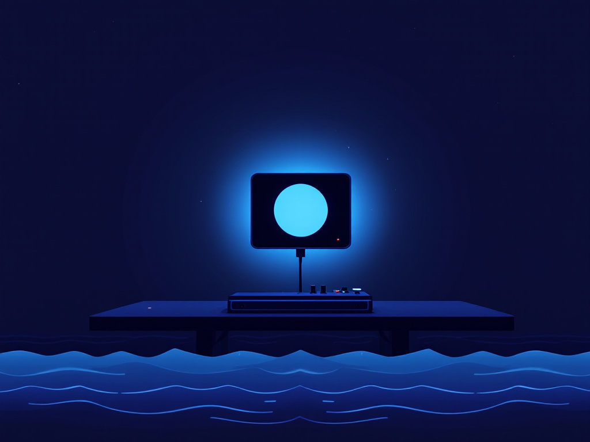

<p align="center">
  
</p>

# FM1-Drydock

**Standalone ESP32-S3 AMOLED firmware loader for the M-VAVE FM-1.**

FM1-Drydock turns a **Waveshare ESP32-S3-Touch-AMOLED-1.8** into a portable, offline firmware cartridge for the M-VAVE FM-1 synthesizer. Sync your favorite open-source firmwares from your PC over USB-C, then take Drydock anywhere to swap instruments, restore official Stock V15, or rescue a stuck FM-1 directly over USB-C.

---

## Features
- **100% Offline Flashing** — Store multiple FM-1 firmwares (SLOOP, Skiff, Hortator, Felucca, etc.) on microSD and flash them on the go.
- **All-USB-C Workflow** — Dual-role USB-C: acts as a USB Mass Storage drive when syncing with your PC, and as a USB Host when flashing the FM-1.
- **Built-in Safety Net** — Dedicated **Official Stock V15** restore and **UBOOT1.00 Rescue** mode directly on the device.
- **Declarative PC Sync** — Maintain a `vessels.toml` list and run `drydock sync` to pull the latest releases from [The Firmware Hub](https://thefirmwarehub.com/), GitHub, or local `.fwsc` files.

## Hardware Requirements
- **Waveshare ESP32-S3-Touch-AMOLED-1.8** (V1 `SH8601/FT3168` and V2 `CO5300/CST820` supported)
- **microSD card** (FAT32)
- **M-VAVE FM-1**
- **USB-C cable** (see `docs/hardware-waveshare-1.8.md` for OTG/VBUS notes)

## Repository Structure
- `firmware/` — ESP-IDF (≥ 5.5) C/C++ firmware with LVGL 9 UI, TinyUSB MSC Device, and USB Host MIDI/Rescue drivers.
- `companion/` — Python (`uv`) CLI (`drydock-sync`) to fetch firmwares and sync the Drydock USB volume.
- `schema/` — Shared `manifest.schema.json` contract between PC and ESP32.
- `docs/` — Hardware notes and FM-1 flashing/rescue protocol documentation.

## Quick Start

### 1. Sync firmwares from PC (`companion/`)
```bash
cd companion
uv sync
cp vessels.example.toml vessels.toml
# Switch your ESP32-S3 to "PC Sync" mode and connect via USB-C
uv run drydock sync
```

### 2. Build & Flash ESP32-S3 (`firmware/`)

```bash
cd firmware
# For V1 board (SH8601 + FT3168)
idf.py -D SDKCONFIG_DEFAULTS="sdkconfig.defaults;sdkconfig.board_v1" set-target esp32s3 build flash monitor

# For V2 board (CO5300 + CST820)
idf.py -D SDKCONFIG_DEFAULTS="sdkconfig.defaults;sdkconfig.board_v2" set-target esp32s3 build flash monitor
```

## License

GPL-3.0 — aligned with the M-VAVE FM-1 open-source firmware ecosystem.
